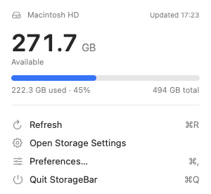
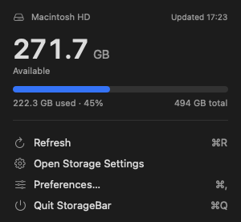

<p align="center"></p>

# StorageBar

A tiny native macOS menu bar app that shows how much free space your startup disk has, for example
`[disk] 274 GB`. Click it for details. No account, no network access, no telemetry.

<p align="center">
  
  
</p>
<p align="center"><sub>Renders of the real views. The popup is shown without the system menu frame and material.</sub></p>

## For users

### Requirements
macOS 15 (Sequoia) or later on an Apple silicon Mac. Developed and tested on macOS 26 (Tahoe).

### Install
1. Download **StorageBar.dmg** from the [Releases page](https://github.com/ahsansabir30/StorageBar/releases).
2. Open it and drag **StorageBar** into **Applications**.
3. Open StorageBar from Applications. Free space appears in the menu bar straight away.

> **Status of public downloads:** the project is ready to publish signed, notarised builds, but no
> Apple Developer ID certificate has been configured yet, so **no notarised release exists yet**.
> Until one does, build from source (see below). An unsigned build will trigger Gatekeeper warnings;
> do not work around them by disabling Gatekeeper.

### Put it next to the battery
macOS controls menu bar order. Hold **⌘ (Command)** and drag the StorageBar item to where you want it,
for example beside the battery icon. macOS remembers the position. If you use *Automatically hide and
show the menu bar*, move the pointer to the top of the screen first so the bar appears, then ⌘-drag.
Items can also be shown or hidden in System Settings › Menu Bar.

### Use it
- **Click** the item for disk name, available space, used space and percentage, a capacity bar and
  the time of the last update. The popup has Refresh, Storage Settings, Preferences and Quit; About is in Preferences.
- **Preferences** (from the popup): launch at login, refresh interval (default 1 minute),
  what the menu bar shows (free GB, free %, used %), the disk icon, and optional low-storage alerts
  (warning below 10 %, critical below 5 % by default; macOS asks for notification permission only when
  you turn alerts on).
- **Launch at login:** Preferences › General. If macOS says approval is needed, allow StorageBar in
  System Settings › General › Login Items.

### What the numbers mean
*Available* is free space plus space macOS can reclaim on demand (purgeable), as Finder and System
Settings report it. *Used* is total minus available. StorageBar only reads the startup disk's
capacity. It never looks at your files.

### Uninstall
Quit StorageBar (from its popup), turn off Launch at login if you enabled it, then delete
StorageBar from Applications. Optionally remove its settings:
`~/Library/Containers/com.ahsan.StorageBar`.

### Troubleshooting
| Problem | What to try |
|---|---|
| I can't see the item | The menu bar may be auto-hiding: move the pointer to the top edge. If the bar is crowded, items near the notch can be hidden; ⌘-drag other items away or remove some in System Settings › Menu Bar. Opening StorageBar again from Applications is designed to show its popup (not yet verified on screen). |
| I opened it twice | Only one copy runs; a second launch just shows the popup. |
| Launch at login does nothing | Approve it in System Settings › General › Login Items. |
| No low-storage alerts | Turn them on in Preferences and allow notifications in System Settings › Notifications. |

## For developers

### Requirements
Xcode 16 or later (developed with Xcode 27.1), Swift 6, macOS 15+ deployment target. No dependencies.

### Build and test
Build outside `~/Documents` or other iCloud-synced folders; file-provider attributes make `codesign`
fail.

```bash
DD=/tmp/StorageBar-dd
xcodebuild -project StorageBar.xcodeproj -scheme StorageBar -derivedDataPath $DD build
xcodebuild -project StorageBar.xcodeproj -scheme StorageBar -derivedDataPath $DD -only-testing:StorageBarTests test
xcodebuild -project StorageBar.xcodeproj -scheme StorageBar -derivedDataPath $DD analyze
open $DD/Build/Products/Debug/StorageBar.app
```

UI tests (`-only-testing:StorageBarUITests`) drive the real app. They need Accessibility permission for
the test runner and a visible menu bar; popup tests are *skipped*, not passed, when the bar is
auto-hidden. CI runs build, unit tests and static analysis only.

### Package a DMG
```bash
scripts/build-release.sh
```
Produces `dist/StorageBar-<version>-LOCAL-UNSIGNED.dmg` (ad-hoc signed, **not notarised**, for local
testing only) plus a SHA-256 file. With signing and notarisation credentials in the environment it
produces `dist/StorageBar.dmg`. See [docs/RELEASING.md](docs/RELEASING.md).

### Architecture
`Core/` holds all logic (snapshot, formatting, thresholds, preferences, polling monitor, system
services) with no UI dependencies. `Views/` is SwiftUI. `StatusItemController` owns the `NSStatusItem`,
the menu that hosts the popup, and the Preferences window. Details and metric definitions:
[docs/ARCHITECTURE.md](docs/ARCHITECTURE.md). Engineering and design rules: `CLAUDE.md` and
`.claude/rules/`.

### Git workflow
`main` stays releasable. Make changes on a short-lived branch (`feature/…`, `fix/…`), run the unit
tests and `analyze` locally, open a pull request, and merge once CI is green. Use Conventional Commits
(`feat:`, `fix:`, `docs:` …). Never force-push `main`.

### CI/CD
- `.github/workflows/ci.yml`: on pull requests and pushes to `main`: Release build, unit tests, static
  analysis, and a packaging dry run that uploads the *unsigned* DMG as a short-lived artefact.
- `.github/workflows/release.yml`: manual. Signs with Developer ID, notarises, staples, verifies,
  checksums, then creates the GitHub Release. It refuses to run, and publishes nothing, if any
  credential is missing.

### Licence
[MIT](LICENSE).
